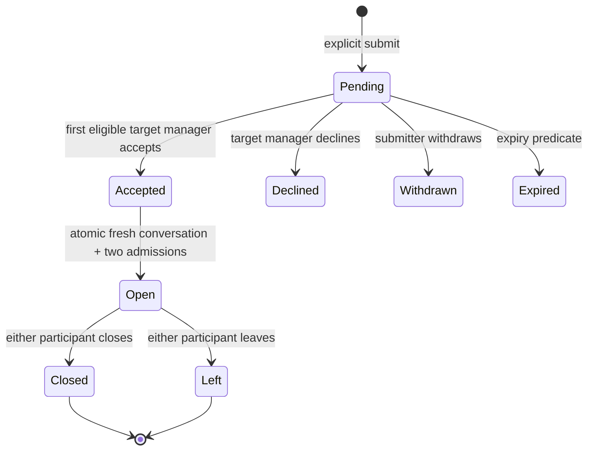

# D00 — Purposeful group contact and coordination

Approval status: **PROVISIONAL — REVIEW ONLY**  
Approval reference: **none**  
Base inspected: `58c5b18` (14 October 2026); Batch A #243 is merged.

This is the proposed contract for the isolated D00–D03 stack. The request to
implement Batch D authorizes preparation and synthetic local verification, not
approval of these private audiences. Do not merge or apply these migrations to
a shared environment until the review choices below have an explicit approval
reference. No runtime toggle substitutes for that gate.

## Fixed direction and provisional choices

Fixed: authenticated humans act for registered groups; Creator, Co-creator and
Co-organizer may represent a group. Contact is purposeful and explicit, grants
no membership or Project authority, and never sends through navigation or setup.
Project attribution is historical authorship, not current representation.

Proposed: group-to-group only, both `informal` and `organization`, using currently
published, nonsuppressed groups with a live completed accountable Creator.
Purposes are `idea` and `collaboration`. A request addresses a group, not a
private roster. A target manager accepts personally. Only the original submitter
and that accepting manager enter the bilateral conversation. A person cannot
contact another group they currently manage or accept their own request.

The submitter consents to current target managers reading the request note.
New target managers may triage still-pending requests while eligible and unblocked;
they inherit no accepted conversation. Resolve manager-wide blocking conservatively:
a block between the submitter and any current target manager suspends pending
triage and acceptance for everyone. The UI reports only unavailable interaction.
Source managers other than the submitter receive no private contact data.

Admission records the human, represented group, and exact delegate grant ID
(null only for the immutable Creator). Changing an active grant between the two
delegate roles preserves admission. Revocation/step-down permanently invalidates
that grant's admission; a new grant does not revive it. Group archive, suppression,
or temporary incomplete accountable identity suspends communication; restoring
eligibility restores otherwise valid admission. Account erasure never transfers it.

## Actor/access matrix

| Actor                                                         | Pending request note                       | Resolved request                                                              | Conversation body/preview/unread        | Commands                                                       |
| ------------------------------------------------------------- | ------------------------------------------ | ----------------------------------------------------------------------------- | --------------------------------------- | -------------------------------------------------------------- |
| Submitter with original live representation                   | Own request                                | Own bounded detail                                                            | Only explicit valid admission           | Submit, withdraw; admitted send/close/leave                    |
| Current eligible target manager                               | Pending note, purpose, human/group context | ID, purpose, title, status and resolution time only; no note/acceptor/chat ID | Only if that human explicitly accepted  | Accept/decline; admitted send/close/leave                      |
| Another source manager                                        | None                                       | None                                                                          | None                                    | May submit their own separate intent, subject to pair limits   |
| New target manager                                            | Eligible pending triage                    | Minimal duplicate-triage metadata                                             | None without a new explicit admission   | Review pending only                                            |
| Former submitter/acceptor                                     | Metadata-only own outcome                  | ID/state/time only, no title/note/names                                       | None, including exact reads/read tokens | Original receipt recovery, safe exit, report own known content |
| Ordinary/pending/former group member; unrelated person; guest | None                                       | None                                                                          | None                                    | No D contact right                                             |
| Staff role alone                                              | None                                       | None                                                                          | None                                    | Existing moderation case/evidence tools only                   |

All protected projections use the same admission predicate: history, exact item,
latest timestamp, preview, participants, unread, acknowledgement, reference and
identifier-only realtime routing. No new generic profile/photo audience is granted.
Contextual human/group display names are returned only inside an authorized D read.
Erased/inaccessible identities render neutrally. Group names at send time are
immutable provenance, not a claim about present affiliation or legal verification.

## Commands and states

Requests expire after seven days (the existing group authority invitation bound).
Expiry is evaluated using database clock time in reads/commands, without cron.
Accept/decline/withdraw require pending and unexpired state; withdraw may also
close an expired unresolved request for own recovery. Closed conversations retain
read-only history for still-valid admissions. Leave permanently ends only the
actor's D admission and makes a bilateral conversation read-only. No reopen or
in-place correction/deletion endpoint: start a new deliberate request. Retention,
anonymization and later lawful removal belong to Plan 10; no arbitrary retention
period, account FK or cascade deletes D records.

Actor/action UUID receipts freeze operation, target and exact submitted intent,
including whitespace. Stored human text is trimmed separately; transport retries
must preserve the original submitted bytes.
Exact replay returns the original identifiers/outcome, never restores authority.
Changed intent is `PT409`. An uncertain transport keeps the same UUID and input;
explicit recovery returns metadata only and zero rows when no action committed.
IDs alone do not prove current authorization. New requests remain possible after
terminal attempts and cooldown. Opening a composer/preview never writes.

## Finite provisional bounds

These are proposed activation values, centralized in the D backend interface,
not an approved spam/retention policy. Exact receipt recovery is exempt from new
action quotas. Exits and reporting are exempt from messaging quotas.

| Bound                          | Proposed value                                            |
| ------------------------------ | --------------------------------------------------------- |
| Title / private request note   | 120 / 1,000 PostgreSQL characters, trimmed, nonempty      |
| Human message                  | 4,000 PostgreSQL characters, trimmed, nonempty            |
| Pending duplicate              | One unexpired unordered group pair                        |
| New requests                   | 10 per actor and 25 per source group per rolling 24 hours |
| Repeat after decline           | Same unordered group pair: 7 days                         |
| Message rate                   | 30 per human per rolling minute across D conversations    |
| Request / coordination expiry  | 7 days; no background deletion                            |
| History/list page              | 1–50 items; compound cursor; one lookahead row            |
| Coordination audience          | 3–5 groups, one distinct human per group                  |
| Pending coordination proposals | 3 per initiating human; 10 new proposals per rolling day  |

Optional Project reference is a server-validated currently public Project UUID.
The read rechecks current public eligibility and returns only public identity;
hidden references become null. Protected location, membership, draft content,
private links and note text never enter a URL, audit or realtime payload.

## D03: exact audience consent and fresh history

D03's [provisional protocol](group-coordination-protocol.md) specifies staged
identity disclosure: new claimants share their own identity/group with the two
original people; both originals must confirm the exact named version before new
claimants receive the complete human audience. Claim/replacement invalidates all
confirmations. This clarification is included in the same founder approval gate.

An admitted bilateral participant proposes a new room with both existing human/
group seats plus one to three additional public groups. Added groups' eligible
managers may claim one seat by explicit acceptance; no public People picker.
Claiming selects a human and exact grant but is not final audience consent.
Once every seat is named, every distinct human must explicitly confirm the exact
versioned audience, including the initiator and original counterparty. A changed
seat/audience invalidates all confirmations. No human represents two seats or
supplies another person's consent. No partially accepted proposal grants chat access.

The final confirmation atomically rechecks all identities, original admissions,
groups, grants, pairwise blocks, expiry, version and confirmations and creates
exactly one linked fresh room. The author-confirmed new summary is the only
initial context. No message, draft, private link, read receipt or unread crosses
from the original conversation. Original source IDs/title/links are visible only
to independently authorized original participants. Invitees receive no dead source
link or source preview. Decline/cancel ends the proposal; re-invitation is a fresh
intent within the finite limits. No in-place audience expansion or arbitrary rooms.

Role loss removes live reads/sends for that seat. Blocking any pair suspends sends
and new activation for the room; otherwise valid existing members retain reads
and safety/exit. Group lifecycle suspension likewise preserves authorized read-only
history, while role revocation denies the revoked human all content. Close keeps
valid members read-only; leave ends only that admission. A room may continue
with at least two valid remaining seats; it never inherits replacement managers.

## Serialization and privacy

Mutations lock actor/action advisory, actor quota (where relevant), all sorted
canonical block pairs, sorted group rows, sorted Auth/profile identities, then
request/conversation/proposal rows. Snapshot complete manager sets before locking
and recheck after waits; a changed set returns neutral `PT409`, without acquiring
new pair locks after group locks. Authority/lifecycle commands already serialize
on group rows. Block uses `private.lock_user_interaction_pair`; D must use the
same key and order. Erasure checks after waits fail closed even with a cached JWT.

Realtime is recipient-scoped, identifier-only and selected using current durable
authorization at emission time. Joining a channel does not prove continuing
permission. Revoked humans receive no later activity hints. Resume/reconnect,
role invalidation and identity A→B→A clear cached private state. No new external
push/email/browser notification kind is introduced. Requests/invitations are
discoverable in Requests and never count as incoming human-message unread.
Acknowledgements require an authorized rendered newest boundary; count only
committed incoming human messages. Source IDs never go in generic event metadata.

## Integration owners inspected

| Boundary              | Effective existing owner / D extension                                                                                                                                                   |
| --------------------- | ---------------------------------------------------------------------------------------------------------------------------------------------------------------------------------------- |
| Group authority       | `private.group_authority_role`, `private.current_group_manager_profile_ids`, `private.require_group_identity`, `private.group_is_public`; D admission binds `private.group_delegates.id` |
| Group exact self      | `get_own_group_membership_context`; no roster inference or inherited affiliation                                                                                                         |
| Group attribution     | `public.projects.attributed_group_id`, `get_public_project_groups`, `list_my_publishable_groups`; D needs its own representative list including Co-organizers                            |
| New interaction locks | `private.lock_user_interaction_pair`, `private.assert_user_interaction_available`, `private.lock_group_interactions`; D sorted multi-group helper                                        |
| Shared conversations  | `list_own_scoped_conversation_items_v5`, `MessageChatItemKind`, `message_chats_gateway.dart`; additive D-capable version, legacy v5 untouched                                            |
| Requests              | `list_own_structured_request_message_items`, `get_own_structured_request_message_item`, sealed `StructuredRequestMessageItem`; versioned D variants and union before paging              |
| Human unread          | `get_own_message_unread_summary`, `acknowledge_own_message_read`, `message_unread_gateway.dart`, `MessageReadViewport`; additive D-aware versions keep legacy totals unchanged           |
| History presentation  | `ConversationHistoryList`; D gateway/access state, no Project tools                                                                                                                      |
| Safety                | Existing private `moderation_cases`/reports and staff evidence projections; additive typed D request/message evidence, no ordinary staff conversation read                               |
| Profile/media         | Existing field/photo audience projections remain unchanged; contextual D names only, no new media grants                                                                                 |
| Setup/routes          | Existing protected continuation and identity-bound route owners after merged A; explicit submit/accept after setup                                                                       |
| Validation            | pgTAP, real OTP/PostgREST independent-transaction verifiers, path-classified Database/Mobile/Web checks                                                                                  |

Shared seams: Messages models/projections, unread, router, localization, generated
Web database types, safety evidence and package verification entry points. D owns
its feature/schema adapters. A signup/cards/workspace and C internal rooms remain
with their existing owners; no universal-chat refactor.

## Three worked examples

1. Alice represents Garden; sends `collaboration` to Workshop with a private note.
   Workshop's current unblocked managers can triage. Bob accepts; Alice and Bob
   alone enter the conversation. Carol, another Workshop manager, sees resolved
   metadata but no note, acceptor identity, chat ID, preview or unread.
2. Bob steps down. His exact grant is revoked; even with the old JWT or read token
   he cannot read/signal/acknowledge/send. His own action receipt remains recoverable
   as metadata and he can report a known received message. A new Bob grant and
   replacement Carol do not inherit the old conversation. Alice retains her own
   authorized history, and starts a fresh contact if needed.
3. Alice proposes a fresh Garden/Workshop/Library room. Dana claims Library's seat.
   Alice, Bob and Dana confirm the exact named audience/version. Only final atomic
   confirmation creates the new room. Dana receives only the fresh summary, never
   Garden/Workshop history, source link, title, previews or prior unread.

## Explicit review gate

| Unresolved founder choice                        | Recommended provisional answer                                                                                                              |
| ------------------------------------------------ | ------------------------------------------------------------------------------------------------------------------------------------------- |
| Initiation and eligible groups                   | Group-to-group; both existing registered types; defer individual-to-group                                                                   |
| Pending recipients and accepted audience         | Current eligible target managers triage; submitter plus first accepting human chat; no automatic inheritance                                |
| Role loss, lifecycle and former history          | Grant-bound live access; revoke/regrant never restores; lifecycle suspension keeps valid read-only history; former own metadata/report only |
| Multi-group model and consent                    | Fresh linked room; named/versioned all-party confirmation; no inherited history                                                             |
| Exit, expiry, repeated requests and abuse limits | Terminal close/leave; no reopen; seven-day requests/cooldown; finite bounds above                                                           |
| Distribution/privacy disclosure                  | Approve recipient explanation and the incremental private contact/message audience before distribution; Plan 10 continues to own retention  |

Record the human approval reference and any exact departures here before activation.
Tests validate the provisional implementation; they cannot approve this table.
